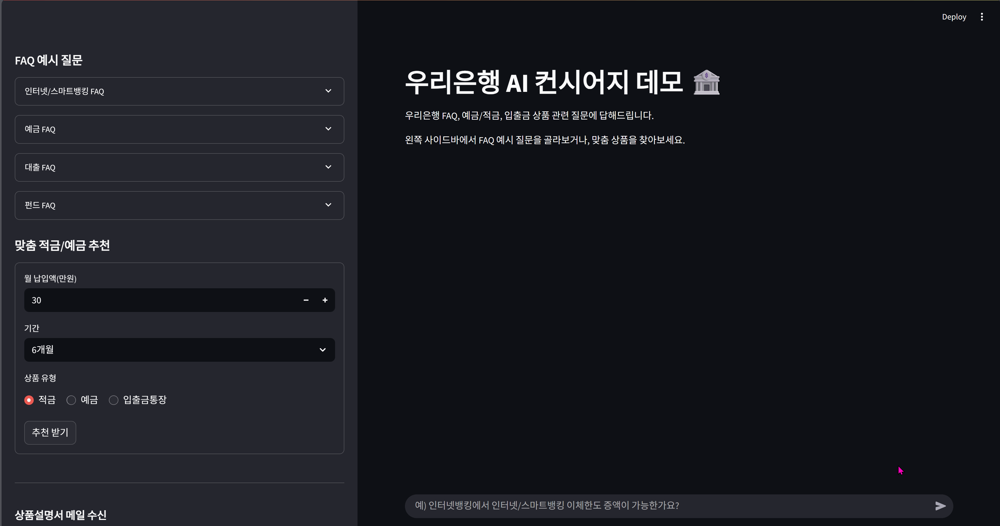

# Finance Agent PoC


우리은행의 FAQ, 예/적금 상품들로 Agent를 구축한다.
LangChain + LangGraph + FAISS + OpenAI LLM, Streamlit UI를 사용하며 추후 예금·대출·보험·펀드 모듈로 확장 가능하도록 모듈 구조를 갖춘다.

## 1. 사전 준비
 - OpenAI API Key – .env 파일에 OPENAI_API_KEY= 입력
 - 의존 라이브러리 설치
```bash
pip install -r requirements.txt
```

## 2. 환경 변수 예시 (.env)
```bash
# 필수
OPENAI_API_KEY=sk-********************************

```

## 3. 인덱스 생성
```bash
python scripts/build_faq_index.py
python scripts/build_deposit_index.py
```

- data를 읽어 Chunk + 메타데이터 생성
- OpenAI Embeddings → FAISS Index 작성 → index/*_faiss/ 저장
- 이미 존재하면 재생성하지 않는다.

## 4. Streamlit 데모 실행
```bash
streamlit run apps/streamlit_app/app.py # 프로젝트 루트 경로에서 실행
```
- 브라우저가 열리면 FAQ 혹은 상품질의를 한국어로 입력
- LLM이 컨텍스트를 인용해 즉시 답변
- 근거 보기 토글로 검색된 context 확인

## Demo


## 5. End-to-End 테스트
```bash
jupyter notebook test_FAQ_rag_e2e.ipynb
jupyter notebook test_product_rag_e2e.ipynb
jupyter notebook test_manager_agent
```
셀 순서대로 실행하면

- 환경변수 로딩 → 인덱스 로드/빌드
- LangGraph 호출 → 샘플 질문 응답
- ragas 평가로 relevancy/faithfulness/precision 리포트 확인